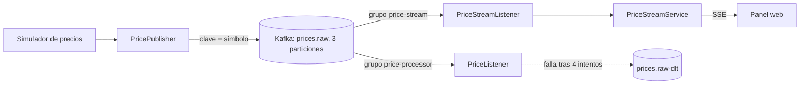

# Crypto Price Tracker

Micro app de **arquitectura orientada a eventos** con Spring Boot y Apache Kafka. Un simulador publica precios de criptomonedas en un topic de Kafka; dos consumidores independientes los procesan: uno registra cada precio y aplica reintentos con **Dead Letter Topic**, y otro los reenvía en vivo a un panel web mediante **Server-Sent Events**.

> **Estado:** en desarrollo. Funcionan el flujo completo, el panel en vivo y la tolerancia a fallos. Pendiente: tests con Testcontainers, CI, API real de precios y despliegue.

## Arquitectura



- **Clave = símbolo.** Los precios de cada moneda caen siempre en la misma partición y conservan el orden.
- **Dos consumer groups sobre el mismo topic.** Cada grupo recibe todos los mensajes y lleva su propio progreso: el log y el panel no se interfieren.
- **Evento en JSON puro** (Jackson 3), sin cabeceras de tipo, legible por cualquier servicio.
- **Tolerancia a fallos.** Si el procesamiento falla, se reintenta 3 veces (1 s entre intentos) y el mensaje se aparca en `prices.raw-dlt` sin detener el flujo.
- **El panel descarta datos inválidos**, así que nunca los muestra.

## Tecnologías

Java 25 · Spring Boot 4.1.2 · Spring for Apache Kafka 4.1.2 · Apache Kafka 4.3.1 (KRaft) · Docker Compose · Server-Sent Events · GitHub Codespaces

## Ejecutarlo

**Opción recomendada: GitHub Codespaces.** Abre el repo en un codespace: el `devcontainer` instala Java, Maven y Docker automáticamente.

```bash
docker compose up -d
./mvnw spring-boot:run
```

En local necesitas JDK 25 y Docker. Después abre el puerto 8080 en el navegador.

| Ruta | Descripción |
|---|---|
| `/` | Panel con tarjetas de precios en vivo |
| `/api/prices/latest` | Últimos precios (JSON) |
| `/api/prices/stream` | Flujo de eventos SSE |
| `/actuator/health` | Estado de la aplicación |

## Probar la tolerancia a fallos

Con la app en marcha, envía un mensaje inválido (precio negativo):

```bash
echo 'BTC|{"symbol":"BTC","price":-1,"timestamp":"2026-10-30T12:00:00Z"}' | docker exec -i kafka /opt/kafka/bin/kafka-console-producer.sh --bootstrap-server localhost:9092 --topic prices.raw --property parse.key=true --property key.separator='|'
```

En el log verás 4 intentos y, después, el mensaje en el DLT:

```bash
docker exec kafka /opt/kafka/bin/kafka-console-consumer.sh --bootstrap-server localhost:9092 --topic prices.raw-dlt --from-beginning --max-messages 1 --timeout-ms 10000 --property print.headers=true
```

Las cabeceras `kafka_dlt-*` indican la excepción, el topic, la partición y el grupo que fallaron.

## Cómo escalarlo

- **Más consumo en paralelo:** el número de particiones es el techo. Con más instancias que particiones, las sobrantes quedan sin trabajo.
- **Producción:** 3 réplicas por topic, `min.insync.replicas=2`, y creación automática de topics desactivada.
- **Varias instancias del panel:** cada instancia mantiene sus conexiones SSE en memoria; con el mismo grupo se repartirían las particiones. Hace falta un grupo propio por instancia.
- **Reintentos:** son bloqueantes (frenan la partición). Para esperas largas se usan reintentos no bloqueantes con topics de reintento.

## Problemas encontrados

- El sufijo por defecto del Dead Letter Topic es `-dlt`, y un nombre distinto pasó desapercibido porque Kafka creó otro topic automáticamente.

## Licencia

MIT