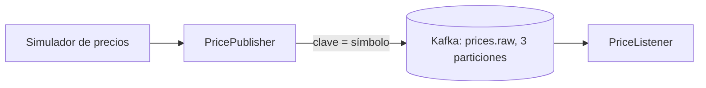

# Crypto Price Tracker

Micro app de **arquitectura orientada a eventos** con Spring Boot y Apache Kafka. Publica precios de criptomonedas (simulados por ahora) en un topic de Kafka y los consume en otro componente, mostrando cómo se desacoplan productor y consumidor.

> **Estado:** en desarrollo. Hecho: productor, consumidor y serialización JSON. Próximo: endpoint SSE y panel en vivo, reintentos con Dead Letter Topic, tests y CI.

## Cómo funciona



- La **clave** del mensaje es el símbolo (`BTC`), así que los precios de cada moneda caen en la misma partición y conservan el orden.
- El evento viaja como JSON puro (Jackson 3), legible por cualquier servicio.

## Tecnologías

Java 25 · Spring Boot 4.1.2 · Spring for Apache Kafka 4.1.2 · Apache Kafka 4.3.1 (KRaft) · Docker Compose · GitHub Codespaces

## Ejecutarlo

Opción recomendada: abrir el repo en **GitHub Codespaces** (el devcontainer instala Java, Maven y Docker).

```bash
docker compose up -d
./mvnw spring-boot:run
```

Verás en el log cada precio con su partición y offset. Comprobación de salud: `/actuator/health`.

## Licencia

MIT
