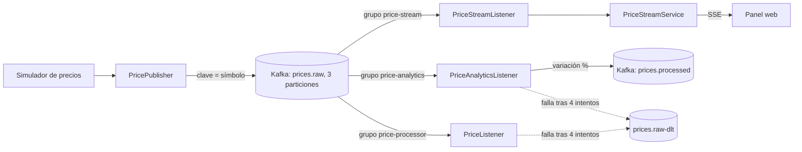

# Crypto Price Tracker

[](https://github.com/CRISHFAS/crypto-price-tracker/actions/workflows/ci.yml)

Micro app de **arquitectura orientada a eventos** con Spring Boot y Apache Kafka. Un simulador publica precios de criptomonedas en un topic de Kafka; tres consumidores independientes los procesan: uno registra cada precio y aplica reintentos con **Dead Letter Topic**, otro los reenvía en vivo a un panel web mediante **Server-Sent Events**, y un tercero calcula la variación porcentual y la publica en un segundo topic, `prices.processed`.

> **Estado:** en desarrollo. Funcionan el flujo completo, el panel en vivo, la tolerancia a fallos y el procesador de variaciones, con tests de integración (Testcontainers) y CI en cada push. Pendiente: API real de precios, carpeta `docs/` y despliegue.

## Arquitectura



- **Clave = símbolo.** Los precios de cada moneda caen siempre en la misma partición y conservan el orden.
- **Tres consumer groups sobre el mismo topic.** Cada grupo recibe todos los mensajes y lleva su propio progreso: el log, el panel y el procesador no se interfieren.
- **Evento en JSON puro** (Jackson 3), sin cabeceras de tipo, legible por cualquier servicio.
- **Tolerancia a fallos.** Si el procesamiento falla, se reintenta 3 veces (1 s entre intentos) y el mensaje se aparca en `prices.raw-dlt` sin detener el flujo.
- **El panel descarta datos inválidos**, así que nunca los muestra.

## El procesador de variaciones

El grupo `price-analytics` lee `prices.raw` (solo mensajes nuevos, `latest`), calcula la variación porcentual respecto al último precio **confirmado** del mismo símbolo y publica un evento en `prices.processed` (3 particiones, clave = símbolo).

- **`eventId` determinista:** `prices.raw:<partición>:<offset>` del mensaje de entrada. Si un mensaje se reentrega, el duplicado se reconoce por el mismo identificador.
- **Primer precio de cada símbolo:** se publica con `previousPrice` y `changePercent` en `null`.
- **Orden de las operaciones:** leer el precio previo, publicar y esperar la confirmación del broker (hasta 10 s) y solo entonces confirmar el estado. Si la publicación falla, se lanza una excepción, se reintenta (4 intentos) y el mensaje acaba en `prices.raw-dlt`; el estado no avanza, así que el reintento recalcula lo mismo.
- **Precios no positivos:** el procesador los descarta sin publicar; los aparca en el DLT el grupo `price-processor`.
- **Tests:** `./mvnw test` ejecuta 17 pruebas: 13 unitarias del analizador y 4 de integración con un Kafka efímero (Testcontainers), que necesitan Docker.

Para ver los eventos procesados:

```bash
docker exec kafka /opt/kafka/bin/kafka-console-consumer.sh --bootstrap-server localhost:9092 --topic prices.processed --from-beginning --max-messages 5 --timeout-ms 10000 --formatter-property print.key=true
```

## Tecnologías

Java 25 · Spring Boot 4.1.2 · Spring for Apache Kafka 4.1.2 · Apache Kafka 4.3.1 (KRaft) · Docker Compose · Server-Sent Events · GitHub Codespaces

## Ejecutarlo

**Opción recomendada: GitHub Codespaces.** Abre el repo en un codespace: el `devcontainer` instala Java, Maven y Docker automáticamente.

```bash
docker compose up -d
./mvnw spring-boot:run
```

En local necesitas JDK 25 y Docker. Después abre el puerto 8080 en el navegador.

| Ruta | Descripción |
|---|---|
| `/` | Panel con tarjetas de precios en vivo |
| `/api/prices/latest` | Últimos precios (JSON) |
| `/api/prices/stream` | Flujo de eventos SSE |
| `/actuator/health` | Estado de la aplicación |

## Probar la tolerancia a fallos

Con la app en marcha, envía un mensaje inválido (precio negativo):

```bash
echo 'BTC|{"symbol":"BTC","price":-1,"timestamp":"2026-10-30T12:00:00Z"}' | docker exec -i kafka /opt/kafka/bin/kafka-console-producer.sh --bootstrap-server localhost:9092 --topic prices.raw --reader-property parse.key=true --reader-property key.separator='|'
```

En el log verás 4 intentos y, después, el mensaje en el DLT:

```bash
docker exec kafka /opt/kafka/bin/kafka-console-consumer.sh --bootstrap-server localhost:9092 --topic prices.raw-dlt --from-beginning --max-messages 1 --timeout-ms 10000 --formatter-property print.headers=true
```

Las cabeceras `kafka_dlt-*` indican la excepción, el topic, la partición y el grupo que fallaron.

## Cómo escalarlo

- **Más consumo en paralelo:** el número de particiones es el techo. Con más instancias que particiones, las sobrantes quedan sin trabajo.
- **Producción:** 3 réplicas por topic, `min.insync.replicas=2`, y creación automática de topics desactivada.
- **Varias instancias del panel:** cada instancia mantiene sus conexiones SSE en memoria; con el mismo grupo se repartirían las particiones. Hace falta un grupo propio por instancia.
- **Reintentos:** son bloqueantes (frenan la partición): en una prueba, el mensaje siguiente salió unos 3,6 s después. Para esperas largas se usan reintentos no bloqueantes con topics de reintento.
- **Estado del procesador:** vive en memoria y se pierde al reiniciar. Tras un reinicio, el primer precio de cada símbolo sale con `previousPrice: null`, y un mensaje ya publicado puede reentregarse y salir otra vez con `previousPrice: null`. Conservarlo requeriría un almacén externo.
- **Entrega al menos una vez:** el procesador no usa transacciones de Kafka, así que un fallo entre publicar y confirmar el offset puede duplicar un evento en `prices.processed`. Los consumidores posteriores deben deduplicar por `eventId`. Las transacciones darían exactamente una vez, pero el estado en memoria no es transaccional.
- **Alcance del `eventId`:** detecta la reentrega del mismo mensaje, no un productor que envía el mismo dato dos veces (esos llevan offsets, y por tanto `eventId`, distintos).

## Problemas encontrados

- El sufijo por defecto del Dead Letter Topic es `-dlt`, y un nombre distinto pasó desapercibido porque Kafka creó otro topic automáticamente.
- Un mensaje que no era JSON bloqueaba el consumidor en bucle (26 MB de log en menos de un minuto); se resolvió con ErrorHandlingDeserializer y un DLT que guarda los bytes originales.
- Al reanudar un codespace detenido, Kafka no arrancó solo: `docker exec` fallaba con «container is not running» y la app, arrancada sin broker, llenó el log (16,5 MB, 2457 avisos de conexión) mientras `/actuator/health` seguía en 200. Se resolvió con `docker compose up -d` y comprobando los offsets antes de arrancar la app. Causa probable, no verificada: la parada del codespace.

## Licencia

MIT
