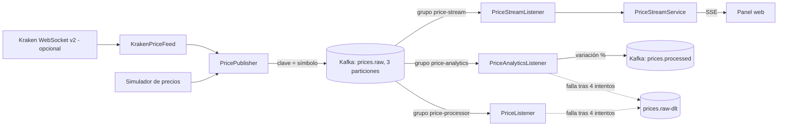

# Arquitectura

Micro app orientada a eventos con Spring Boot y Apache Kafka. Un origen de precios (el simulador, o Kraken si se enciende) publica en un topic, y tres grupos de consumidores independientes los procesan.

## Diagrama

## Topics

| Topic | Particiones | Clave | Valor | Para qué sirve |
|---|---|---|---|---|
| `prices.raw` | 3 | símbolo | `PriceEvent` en JSON | Precios tal como llegan del origen |
| `prices.processed` | 3 | símbolo | `PriceProcessedEvent` en JSON | Precio con su variación porcentual |
| `prices.raw-dlt` | 3 | la del mensaje original | el mensaje original (JSON legible, o bytes crudos si era ilegible) | Mensajes que fallaron; las cabeceras `kafka_dlt-*` indican el grupo, la excepción y el origen |

Los tres tienen 1 réplica porque en local hay un solo broker; en producción serían 3.

## Consumer groups

| Grupo | Clase | Lee con | Qué hace |
|---|---|---|---|
| `price-processor` | `PriceListener` | `earliest` | Registra cada precio, rechaza los no positivos y, tras 4 intentos, aparca el mensaje en el DLT |
| `price-stream` | `PriceStreamListener` | `latest` | Reenvía los precios válidos al panel por SSE |
| `price-analytics` | `PriceAnalyticsListener` | `latest` | Calcula la variación porcentual y publica en `prices.processed` |

Los tres comparten el manejador de errores: 4 intentos con 1 s entre ellos y después, el DLT. Los mensajes ilegibles no se reintentan.

## Paquetes

| Paquete o carpeta | Contenido |
|---|---|
| `config` | `KafkaConfig`: los topics, el manejador de errores y las dos plantillas del DLT |
| `model` | `PriceEvent` y `PriceProcessedEvent`, inmutables |
| `messaging` | Publicador, simulador, los tres listeners y `PriceStreamService` |
| `processing` | `PriceAnalyzer`: el estado y el cálculo de la variación, sin Kafka |
| `feed` | Precios reales de Kraken: `KrakenPriceFeed` (conexión), `KrakenTickerParser` (mensajes), `ReconnectBackoff` (espera) y `TextAssembler` (mensajes partidos) |
| `web` | `PriceController` con las rutas `/api/prices/latest` y `/api/prices/stream` |
| `static` | `index.html`: el panel con tarjetas, mini gráficas y reconexión automática |

## Configuración

| Propiedad | Valor por defecto | Efecto |
|---|---|---|
| `app.simulator.enabled` | `true` | Genera precios simulados cada 2 s |
| `app.kraken.enabled` | `false` | Conecta con el WebSocket v2 de Kraken |
| `app.kraken.url` | `wss://ws.kraken.com/v2` | Dirección del WebSocket |
| `app.kraken.symbols` | `BTC/USD,ETH/USD,SOL/USD` | Pares a los que suscribirse (solo cotizados en USD) |

Spring Boot enlaza las variables de entorno con las propiedades (`APP_KRAKEN_ENABLED=true`, por ejemplo).

## Pruebas

46 pruebas: 42 unitarias (analizador de precios 13, analizador de Kraken 13, espera de reconexión 6, acumulador de mensajes 5 y cliente de Kraken 5) y 4 de integración con un Kafka efímero de Testcontainers (contexto, flujo completo y dos de fallos). El CI las ejecuta en cada push.
