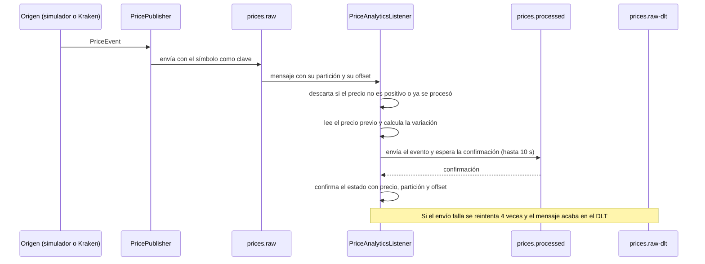

# Flujo de eventos

Cómo viaja un precio por el sistema, qué forma tienen los dos eventos y qué ocurre cuando algo falla. Los ejemplos de JSON son mensajes reales capturados durante las pruebas.

## Recorrido de un precio



Los otros dos grupos (`price-processor` y `price-stream`) leen el mismo mensaje de `prices.raw` de forma independiente.

## Evento de entrada: `PriceEvent`

| Campo | Tipo | Descripción |
|---|---|---|
| `symbol` | texto | Símbolo de la moneda (`BTC`, `ETH`, `SOL`). Es también la clave del mensaje |
| `price` | decimal | Precio. Se descarta si es nulo o no positivo |
| `timestamp` | instante UTC | Momento del precio: el del dato en Kraken, o el del reloj en el simulador |

Ejemplo real (de `/api/prices/latest`, que devuelve este mismo formato):

```json
{"symbol":"BTC","price":74587.7,"timestamp":"2026-11-11T21:10:27.653291Z"}
```

## Evento de salida: `PriceProcessedEvent`

| Campo | Tipo | Descripción |
|---|---|---|
| `eventId` | texto | `prices.raw:<partición>:<offset>` del mensaje de entrada. Determinista: una reentrega produce el mismo identificador |
| `version` | entero | Versión del esquema (1) |
| `symbol` | texto | Símbolo. También es la clave del mensaje |
| `price` | decimal | Precio validado |
| `previousPrice` | decimal o `null` | Último precio confirmado del símbolo. `null` en el primero |
| `changePercent` | decimal o `null` | (precio − previo) × 100 / previo, con 4 decimales. `null` si no hay precio previo |
| `sourceTimestamp` | instante UTC | El `timestamp` del evento de entrada |
| `processedAt` | instante UTC | Cuándo se procesó |

Ejemplos reales (SOL, capturados el 02/11/2026): el primer precio tras arrancar y el siguiente.

```json
{"eventId":"prices.raw:0:102","version":1,"symbol":"SOL","price":151.14,"previousPrice":null,"changePercent":null,"sourceTimestamp":"2026-11-02T12:12:32.481242499Z","processedAt":"2026-11-02T12:12:32.500068788Z"}
{"eventId":"prices.raw:0:103","version":1,"symbol":"SOL","price":150.43,"previousPrice":151.14,"changePercent":-0.4698,"sourceTimestamp":"2026-11-02T12:12:34.481096656Z","processedAt":"2026-11-02T12:12:34.496881328Z"}
```

## Qué ocurre cuando algo falla

| Caso | Qué pasa | Dónde queda |
|---|---|---|
| Precio no positivo | `price-processor` lanza una excepción y reintenta 4 veces. `price-stream` y `price-analytics` lo descartan sin publicar | Un registro en `prices.raw-dlt`, del grupo `price-processor`. Nada en `prices.processed` |
| Mensaje que no es JSON | El deserializador envuelto lo convierte en un error sin reintentos | Un registro por grupo (tres) en `prices.raw-dlt`, con el texto original sin cambios |
| Fallo al publicar en `prices.processed` | `price-analytics` lanza `IllegalStateException`, reintenta 4 veces y el estado no avanza | Un registro en `prices.raw-dlt`. El siguiente precio se calcula contra el último confirmado |
| Reentrega del mismo mensaje | La guarda lo salta si la partición coincide y el offset es menor o igual al confirmado | No se publica otra vez mientras el estado siga en memoria. Tras un reinicio sí puede repetirse, y el `eventId` permite detectarlo |
| Reinicio de la aplicación | El estado en memoria se pierde | El primer precio de cada símbolo sale con `previousPrice` y `changePercent` en `null` |

## Cabeceras de un registro del DLT

- `kafka_dlt-original-consumer-group`: el grupo que falló.
- `kafka_dlt-exception-fqcn`: la excepción. Para un fallo del listener es `ListenerExecutionFailedException`, y para un mensaje ilegible, `DeserializationException`.
- `kafka_dlt-exception-cause-fqcn`: la causa (por ejemplo `IllegalStateException`).
